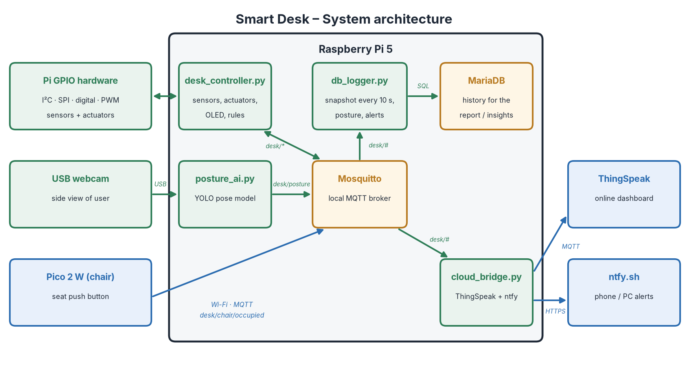

# Smart Desk

IoT Essentials group project (Thomas More, 2026–2027) – **Eggermont Dimitri** & **Lauwers Björn**

A smart desk that tracks presence and seated time, corrects posture with AI,
and controls light, sunshade and cooling. Built on a **Raspberry Pi 5** and a
**Raspberry Pi Pico 2 W**, with a local OLED dashboard and an online
ThingSpeak dashboard.



## Repository layout

```
smart-desk/
├── pi/                     # Everything that runs on the Raspberry Pi 5
│   ├── config.py           # THE contract: pins, thresholds, MQTT topics, settings
│   ├── desk_controller.py  # Main program: sensors → rules → actuators, OLED
│   ├── posture_ai.py       # Webcam + YOLO pose → publishes desk/posture
│   ├── cloud_bridge.py     # desk/# → ThingSpeak (every 15 s) and ntfy alerts
│   ├── db_logger.py        # desk/# → MariaDB (snapshot every 10 s, posture changes, alerts)
│   ├── database.py         # Small MariaDB wrapper used by the logger and the report
│   ├── db_report.py        # Work habits per day + chart from the database
│   ├── check_setup.py      # Verifies the Pi environment (run after setup)
│   ├── sensors/            # One small class per sensor
│   ├── actuators/          # One small class per actuator
│   └── tests/              # One stand-alone test script per component
├── pico/                   # CircuitPython code for the Pico 2 W (seat sensor)
│   ├── code.py
│   └── settings.toml.example
├── config/mosquitto/       # Broker config (allows the Pico to connect)
├── db/                     # MariaDB schema + handy queries
├── scripts/setup_pi.sh     # One-time setup of a fresh Pi
├── scripts/setup_db.sh     # Creates the database, user and tables from .env
├── docs/                   # Report, diagrams
├── requirements.txt        # Pi Python packages (core)
├── requirements-ai.txt     # Pi Python packages (AI, large download)
└── .env.example            # Template for secrets → copy to .env
```

## Getting started on the Raspberry Pi 5

1. Clone the repo on the Pi (we work on the Pi through VS Code **Remote-SSH**):
   ```bash
   cd ~
   git clone https://github.com/Dimi-TM-89/smart-desk.git
   cd smart-desk
   ```
2. Run the one-time setup (installs packages, enables I²C/SPI/PWM, creates the
   virtual environment `.venv`, configures Mosquitto):
   ```bash
   bash scripts/setup_pi.sh            # add --no-ai to skip the large AI packages
   sudo reboot
   ```
3. Create your own secrets file and fill it in:
   ```bash
   cp .env.example .env
   nano .env
   ```
4. Create the database (uses `DB_PASSWORD` from `.env`, choose one first):
   ```bash
   bash scripts/setup_db.sh
   ```
5. Check that everything works:
   ```bash
   source .venv/bin/activate
   python pi/check_setup.py
   ```

In VS Code, select `.venv/bin/python` as the interpreter.

## Getting started on the Pico 2 W

1. Install CircuitPython for the **Pico 2 W** (UF2 from circuitpython.org).
2. Copy the libraries `adafruit_minimqtt` and `adafruit_connection_manager`
   from the CircuitPython library bundle to `CIRCUITPY/lib/`.
3. Copy `pico/settings.toml.example` to `CIRCUITPY/settings.toml` and fill in
   the Wi-Fi details and the Pi's IP address.
4. Copy `pico/code.py` to `CIRCUITPY/code.py`.

## Hardware configuration

All pin numbers (BCM) live in [`pi/config.py`](pi/config.py). Change them
**only there**. Summary:

| Function | GPIO |
|---|---|
| I²C SDA / SCL (BH1750, BMP280) | 2 / 3 |
| SPI0 SCLK / MOSI / MISO (MCP3008) | 11 / 10 / 9 |
| MCP3008 CS | 24 |
| SPI1 SCLK / MOSI (OLED pins "SCL" / "SDA") | 21 / 20 |
| OLED DC / RES (no CS pin) | 6 / 4 |
| Desk lamp LEDs (hardware PWM) | 12 |
| RGB LED R / G / B | 13 / 5 / 26 |
| Stepper IN1–IN4 | 17 / 27 / 22 / 23 |
| Ultrasonic TRIG / ECHO | 14 / 15 |
| Fan relay | 16 |
| Fan button | 25 |
| Shade button | 7 |

Pico: seat button on **GP15** (to GND, internal pull-up).

The desk lamp uses **real hardware PWM**: the single-channel overlay
`dtoverlay=pwm,pin=12,func=4` (set by the setup script) hands GPIO12 to the
PWM block of the Pi 5, and `pi/actuators/hw_pwm.py` drives it through
`/sys/class/pwm`. Blinka's `pwmio` is not used for the lamp: on the Pi 5 it
only offers software-timed PWM (`lgpio.tx_pwm`), and it cannot claim a pin the
overlay owns. GPIO13 stays a plain output for the RGB LED.

SPI0 normally claims two chip-select pins, GPIO8 and GPIO7. The MCP3008 uses
its own CS (GPIO24), so the setup script adds `dtoverlay=spi0-1cs`: SPI0 then
keeps only GPIO8, and GPIO7 is free for the shade button. `check_setup.py`
checks that GPIO7 can be claimed.

The OLED module has no CS pin, so it cannot share SPI0 with the MCP3008. It
runs on SPI1 (`dtoverlay=spi1-1cs`, also set by the setup script). That
overlay also claims GPIO18 and GPIO19: do not use them.

GPIO14/15 (ultrasonic) are the UART pins. While the serial port uses them,
the controller shows `xGpioHandleRequest: Invalid argument` and skips the
HC-SR04. The setup script switches the serial port off; to do it by hand:

```bash
pinctrl get 14,15    # TXD0 / RXD0 = still used by the serial port
sudo sed -i 's/^dtparam=uart0=on/#dtparam=uart0=on/' /boot/firmware/config.txt
sudo sed -i 's/console=serial0,115200 //' /boot/firmware/cmdline.txt
sudo reboot
```

## MQTT topics

| Topic | Publisher | Payload |
|---|---|---|
| `desk/chair/occupied` | Pico | `1` / `0` |
| `desk/presence` | desk_controller | `1` / `0` |
| `desk/posture` | posture_ai | JSON `{"state": "good|bad|none", "angle": 12.3}` |
| `desk/env` | desk_controller | JSON `{"lux", "temp", "window", "threshold", "distance"}` (every second) |
| `desk/actuators` | desk_controller | JSON `{"lamp", "fan", "shade"}` |
| `desk/seated` | desk_controller | seated time in minutes, e.g. `12.5` |
| `desk/alert` | desk_controller | text |

Watch everything live on the Pi:
```bash
mosquitto_sub -h localhost -t 'desk/#' -v
```

## Running the Smart Desk

Each program runs in its own terminal (later as a systemd service). They only
talk to each other through the local Mosquitto broker:

```bash
python pi/desk_controller.py   # sensors, rules, actuators, OLED
python pi/posture_ai.py        # webcam → desk/posture
python pi/cloud_bridge.py      # → ThingSpeak + ntfy
python pi/db_logger.py         # → MariaDB
```

Without hardware, `python pi/tests/simulate_desk.py --alert` stands in for the
first two, so the cloud bridge and the database can be tested on their own.

### Climate rules (desk_controller.py, layer 2)

| Part | Automatic rule | Button |
|---|---|---|
| Desk lamp (PWM) | Closed loop: dims up until the BH1750 reaches the threshold set with the potentiometer, dims down when daylight comes back | – |
| Fan (relay) | On above 25 °C, off below 24 °C | GPIO25 toggles it |
| Sunshade (stepper) | Closes above 70 % window light, opens below 50 % | GPIO7 toggles it, also while it moves |

A button press holds until the automatic rule changes its mind (the sun goes
away, the room cools down) or until the button is pressed again; then the rule
is in charge again. All limits are in `config.Limits`.

### Presence and seat (desk_controller.py, layer 3)

| Input | Effect |
|---|---|
| HC-SR04 sees someone at the entrance, the seat is occupied, or a button is pressed | Desk is awake: `desk/presence` = 1 |
| None of these for `STANDBY_AFTER_S` (demo 30 s) | Standby: lamp and fan off (the sunshade keeps working) |
| Pico: seat occupied | Seated timer starts; published on `desk/seated` in minutes |
| Seated for `SEATED_LIMIT_S` (demo 1 min) | Movement reminder on `desk/alert` (→ ntfy), repeated every `SEATED_LIMIT_S` |
| Up for less than `BREAK_MIN_S` (demo 10 s) | Timer goes on (shifting, grabbing a coffee) |
| Up for at least `BREAK_MIN_S` | Real break: the timer starts again from 0 |

The controller starts in standby; walk in, sit down or press a button to wake it.

### Posture feedback and OLED (desk_controller.py, layer 4)

| Input | Effect |
|---|---|
| `desk/posture` good / bad | RGB LED green / red |
| `desk/posture` none, or no message for 5 s (`posture_ai.py` not running) | RGB LED blue, OLED shows `Posture -` |
| Bad posture for `BAD_POSTURE_AFTER_S` (10 s) | Warning on `desk/alert` (→ ntfy), at most once per `ALERT_COOLDOWN_S` (demo 1 min) |
| Standby | RGB LED off, OLED shows `Standby` and the time |

OLED status screen (refreshed every second; `man` = set by a button, `auto` = set by the rule):

```
SMART DESK      14:32
Desk  312lx (>300)
23.5C  Fan ON  man
Shade 100%  auto
Seat 12m  Posture OK
```

When a movement reminder or posture warning is sent, it fills the screen
(black on white) for 5 s: `TIME TO MOVE!` or `SIT UP STRAIGHT`.

### Multithreading

`desk_controller.py` runs four threads (course lesson 5):

| Thread | Job |
|---|---|
| main | Buttons (20× per second), sensors and rules (every second), publishing |
| shade (`actuators/shade_mover.py`) | Moves the stepper; a full open/close takes ~3 s |
| ultrasonic (`sensors/ultrasonic_watcher.py`) | Measures the HC-SR04 non-stop (~5× per second); one distance takes ~0.2 s |
| MQTT network (paho `loop_start()`) | Sends and receives; seat (Pico) and posture (`posture_ai.py`) messages arrive here |

Without the extra threads, every shade movement (3 s) and every distance
(0.2 s) would block the main loop, and a short button press could be missed.

How they share data safely:
- **Shade:** the main thread only sets a target. The shade thread steps
  towards it in small chunks and checks the target after each chunk, so a
  button press turns the shade around at once. The target is protected by a
  `threading.Condition` (a lock plus a wake-up signal).
- **Ultrasonic:** the thread writes the newest distance and the time it last
  saw someone under a `threading.Lock`; the main thread only reads them.
- **MQTT:** `on_message` does nothing but put the message in a `queue.Queue`;
  the main thread takes it out and owns all seat, timer and posture state.

At Ctrl+C the shade is driven back to open, the start position every program
assumes, and the threads are stopped with `join()`.

## Database

MariaDB on the Pi (course lesson 8a), database `smartdesk`, written only by
`db_logger.py`. No camera images are stored, only the posture result.

| Table | One row … | Columns |
|---|---|---|
| `readings` | every 10 s (`DB_LOG_INTERVAL_S`) | lux, temperature, window_pct, threshold, presence, seated, seated_min, posture, lamp_pct, fan_on, shade_pct |
| `posture` | per posture change | state (good/bad/none), angle |
| `alerts` | per alert sent | kind (movement/posture/other), message |

Because a snapshot is written every 10 s, durations are simply
*rows × 10 s* (seated time, time with good posture, fan time).

```bash
python pi/db_report.py             # work habits per day + latest values
python pi/db_report.py --plot      # also saves db_report.png (last 24 h)
mariadb -u smartdesk -p smartdesk  # SQL prompt; see db/queries.sql for examples
```

phpMyAdmin from the course works too: log in as `smartdesk` with `DB_PASSWORD`.

## Way of working

- `main` always works. Make a branch for each feature
  (`git switch -c feature/ultrasonic`) and merge when it runs on the Pi.
- Always `git pull` before you start and `git push` when you stop.
- Never commit `.env` or `settings.toml` (they contain passwords). They are in
  `.gitignore`.
- Every file starts with a header comment, every class and function has a
  docstring – this is part of the grading.

## Team

| Member | Role |
|---|---|
| Eggermont Dimitri | Team leader / Software |
| Lauwers Björn | Documentation / Hardware |
